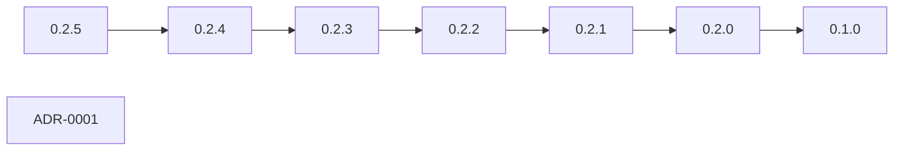

# Governance Change Atlas

<!-- Generated by moonweave-skills docs-index --view changes. Edit CHANGELOG.md and document frontmatter, not this file. -->

This is the change graph. Each release points at the previous release. Each decision points at the record it supersedes. Each hot canonical record appears once, on the date it last changed.

## Release chain

Source: `governance-skills/CHANGELOG.md`.

| Version | Date | Previous | Changes |
|---|---|---|---|
| 0.2.5 | 2026-11-02 | 0.2.4 | Changed: The document graph now loads as a bounded atlas, a one-hop neighborhood, and a release change chain. Changed: New hot canonical records must supersede an existing record or declare a new authority, and progress diaries are rejected. Changed: Every skill carries a delivery contract: a build or fix finishes as a working change. |
| 0.2.4 | 2026-08-06 | 0.2.3 | Changed: Add unified governance document metadata requirements (status, Owner, dates, review cadence, canonical source, superseded-by) across the knowledge base. Changed: Register the live paired evaluation prompt as a typed research asset and align metadata guidance with maintainer feedback. Changed: Regenerate adapters, checksums, and release metadata for version 0.2.4 after the failed v0.2.4 tag (package was still 0.2.3 at publish time). |
| 0.2.3 | 2026-07-22 | 0.2.2 | Changed: Fix CLI router under-rating high-risk production/deploy cases found by the live paired evaluation (Cursor): "deploy to production without review" was misclassi… Changed: Sync every `SKILL.md` frontmatter `metadata.version` to the package version during `build:adapters`, so skill metadata never drifts from the release (all 25 we… Changed: Record the first live paired evaluation (Cursor, all sections 1.00) in `05-Knowledge/research-logs/0001-live-paired-evaluation.md`. |
| 0.2.2 | 2026-07-22 | 0.2.1 | Changed: Fix `moonweave-pull-request` SKILL.md frontmatter: the English `description` contained an unquoted `Pull Request: ` sequence that caused standard YAML parsers … Changed: Add a lint rule `description-unquoted-colon` that flags any skill description with an unquoted `: ` sequence, preventing recurrence. Includes a regression test. Changed: No skill semantic changes; existing evaluations remain valid. |
| 0.2.1 | 2026-07-22 | 0.2.0 | Changed: First release published via the `release.yml` GitHub Actions workflow with `npm publish --provenance` (Sigstore / SLSA v1 provenance, GitHub OIDC). The publish… Changed: Republish to align the npm registry with the repository after the 0.2.0 tarball was found to be a pre-fix artifact (its internal `release-manifest` still read … Changed: Relocate `.github/` to the repository root so CI, CODEOWNERS, and Issue/PR templates function; keep a package-local `.github/` for `install --withGithub` and t… Changed: Bump GitHub Actions to Node 24 and `codeql-action/upload-sarif` to v4 across root workflows, package-local workflows, and the `installGithub` template. Changed: Add repo-root `SECURITY.md`, `CONTRIBUTING.md`, `CHANGELOG.md` as the public repository surface. Changed: No skill semantic changes; existing evaluations remain valid. |
| 0.2.0 | 2026-07-22 | 0.1.0 | Changed: Add `moonweave-help` (skill picker) and `moonweave-flow` (staged multi-skill runner), bringing the total to 25 focused Agent Skills with 25 thin command wrappe… Changed: Regenerate all platform adapters and checksums against the 25-skill set. Changed: Correct `release-manifest.json` content counts (skills/commands 23 → 25) and align the manifest version with `package.json`. Changed: Fix the governance-audit GitHub Action to run from the `governance-skills/` working directory so the SARIF audit uploads correctly. Changed: Correct `.moonweave/governance.json`: canonical language is English (`en`); maturity re-stated as M3 (pre-publication). Will return to M7 after publication, si… Changed: No skill semantic changes in this release; existing evaluations remain valid. |
| 0.1.0 | 2026-07-22 | - | Changed: First complete release. Changed: 23 focused Agent Skills with 23 thin command wrappers. Changed: Supports Cursor, Codex, Claude Code, OpenCode, Kilo, Antigravity, and the generic `.agents/skills` format. Changed: Provides a project installer, doctor, route, artifact generation, repository audit, skill lint, and checksum. Changed: Provides GitHub Issue / PR / Action templates, Claude / Kilo / Antigravity marketplace metadata, and skills.sh install instructions. Changed: Introduces risk S0–S5, quality QA-L0–L5, maturity M0–M9, and the governance traceability matrix. +1 more in the changelog |

## Decision chains

| Scope | Current | History |
|---|---|---|
| repository-root-and-release-manifest | [ADR-0001](https://github.com/Moonweave-AI/governance/blob/v0.2.5/05-Knowledge/adr/0001-github-root-and-release-manifest-unification.md) | - |

## Canonical records by last change

### 05-Knowledge

| Record | Updated | Neighbors | Summary |
|---|---|---:|---|
| [Documentation Writing and Knowledge Asset Management Standards](https://github.com/Moonweave-AI/governance/blob/v0.2.5/05-Knowledge/en/01-Documentation-Guide.md) | 2026-11-02 | 8 | Rules for one canonical record per fact, a bounded document atlas, a release change graph, and finishing a build with the working change. |
### 01-Foundation

| Record | Updated | Neighbors | Summary |
|---|---|---:|---|
| [Kaguya Project Principles](https://github.com/Moonweave-AI/governance/blob/v0.2.5/01-Foundation/en/01-Principles.md) | 2026-08-08 | 4 | - |
| [Security, Privacy, and Responsibility Boundaries](https://github.com/Moonweave-AI/governance/blob/v0.2.5/01-Foundation/en/02-Security-Ethics.md) | 2026-08-08 | 13 | - |
### 02-Governance

| Record | Updated | Neighbors | Summary |
|---|---|---:|---|
| [Organizational Structure and Responsibility Model](https://github.com/Moonweave-AI/governance/blob/v0.2.5/02-Governance/en/01-Organization.md) | 2026-08-08 | 7 | - |
| [Community Health and Contributor Growth](https://github.com/Moonweave-AI/governance/blob/v0.2.5/02-Governance/en/02-Community.md) | 2026-08-08 | 3 | - |
### 03-Collaboration

| Record | Updated | Neighbors | Summary |
|---|---|---:|---|
| [Communication Standards](https://github.com/Moonweave-AI/governance/blob/v0.2.5/03-Collaboration/en/01-Communication.md) | 2026-08-08 | 5 | - |
| [Collaboration Planning Standards](https://github.com/Moonweave-AI/governance/blob/v0.2.5/03-Collaboration/en/02-Planning.md) | 2026-08-08 | 6 | - |
| [RFC Process](https://github.com/Moonweave-AI/governance/blob/v0.2.5/03-Collaboration/en/03-RFC-Process.md) | 2026-08-08 | 7 | - |
### 04-Engineering

| Record | Updated | Neighbors | Summary |
|---|---|---:|---|
| [Engineering Workflow](https://github.com/Moonweave-AI/governance/blob/v0.2.5/04-Engineering/en/01-Workflow.md) | 2026-08-08 | 13 | - |
| [Quality Assurance Standards](https://github.com/Moonweave-AI/governance/blob/v0.2.5/04-Engineering/en/02-Quality-Assurance.md) | 2026-08-08 | 6 | - |
| [ai-systems](https://github.com/Moonweave-AI/governance/blob/v0.2.5/04-Engineering/standards/ai-systems.md) | 2026-08-08 | 8 | - |
| [api-and-protocols](https://github.com/Moonweave-AI/governance/blob/v0.2.5/04-Engineering/standards/api-and-protocols.md) | 2026-08-08 | 4 | - |
| [backend](https://github.com/Moonweave-AI/governance/blob/v0.2.5/04-Engineering/standards/backend.md) | 2026-08-08 | 5 | - |
| [frontend](https://github.com/Moonweave-AI/governance/blob/v0.2.5/04-Engineering/standards/frontend.md) | 2026-08-08 | 2 | - |
### 05-Knowledge

| Record | Updated | Neighbors | Summary |
|---|---|---:|---|
| [ADR-0001](https://github.com/Moonweave-AI/governance/blob/v0.2.5/05-Knowledge/adr/0001-github-root-and-release-manifest-unification.md) | 2026-08-08 | 2 | - |
| [Experiment Log: Live Paired Evaluation of Moonweave Skills](https://github.com/Moonweave-AI/governance/blob/v0.2.5/05-Knowledge/research-logs/0001-live-paired-evaluation.md) | 2026-08-08 | 3 | - |
| [Live Paired Evaluation — Agent Self-Test Prompt](https://github.com/Moonweave-AI/governance/blob/v0.2.5/05-Knowledge/research-logs/live-evaluation-prompt.md) | 2026-08-08 | 1 | - |
### 06-Glossary

| Record | Updated | Neighbors | Summary |
|---|---|---:|---|
| [用語集](https://github.com/Moonweave-AI/governance/blob/v0.2.5/06-Glossary/README.ja.md) | 2026-08-08 | 8 | - |
| [Glossary](https://github.com/Moonweave-AI/governance/blob/v0.2.5/06-Glossary/README.md) | 2026-08-08 | 8 | - |
| [术语表](https://github.com/Moonweave-AI/governance/blob/v0.2.5/06-Glossary/README.zh.md) | 2026-08-08 | 8 | - |
| [Governance & Process](https://github.com/Moonweave-AI/governance/blob/v0.2.5/06-Glossary/en/01-governance-and-process.md) | 2026-08-08 | 4 | - |
| [Engineering & Development](https://github.com/Moonweave-AI/governance/blob/v0.2.5/06-Glossary/en/02-engineering-and-development.md) | 2026-08-08 | 2 | - |
| [Quality & Testing](https://github.com/Moonweave-AI/governance/blob/v0.2.5/06-Glossary/en/03-quality-and-testing.md) | 2026-08-08 | 2 | - |
| [Security & Compliance](https://github.com/Moonweave-AI/governance/blob/v0.2.5/06-Glossary/en/04-security-and-compliance.md) | 2026-08-08 | 2 | - |
| [AI, Agent & Data](https://github.com/Moonweave-AI/governance/blob/v0.2.5/06-Glossary/en/05-ai-agent-and-data.md) | 2026-08-08 | 3 | - |
| [Infrastructure & Operations](https://github.com/Moonweave-AI/governance/blob/v0.2.5/06-Glossary/en/06-infrastructure-and-operations.md) | 2026-08-08 | 3 | - |
| [Embodiment & Robotics](https://github.com/Moonweave-AI/governance/blob/v0.2.5/06-Glossary/en/07-embodiment-and-robotics.md) | 2026-08-08 | 3 | - |
| [Documentation & Knowledge Management](https://github.com/Moonweave-AI/governance/blob/v0.2.5/06-Glossary/en/08-documentation-and-knowledge.md) | 2026-08-08 | 2 | - |
